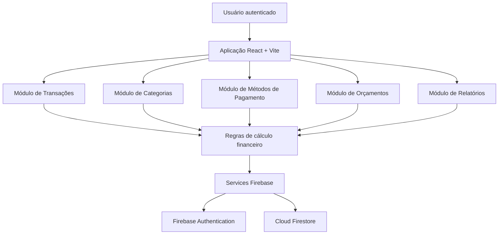
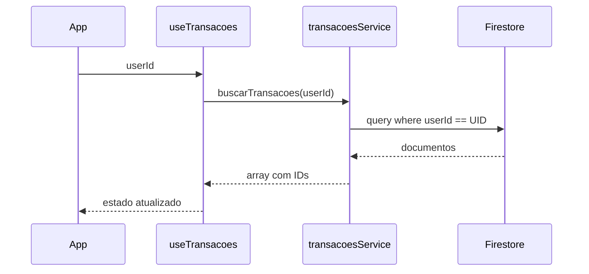

# Software Design Document - Vesttor

## 1. Informações do documento

- **Projeto:** Vesttor - Gestor Financeiro
- **Tipo:** Aplicação web de controle e planejamento financeiro pessoal
- **Responsável:** Eduardo Bernardo do Nascimento
- **Curso:** Análise e Desenvolvimento de Sistemas
- **Disciplina:** Engenharia de Software A
- **Stack principal:** React, Vite, Firebase Authentication e Cloud Firestore
- **Status:** Desenvolvimento e aprendizado
- **Objetivo técnico:** Documentar a estrutura atual do sistema e orientar sua evolução

---

## 2. Visão geral

O Vesttor é uma aplicação web voltada ao controle e planejamento financeiro pessoal. O sistema permite que uma pessoa autenticada cadastre, edite, exclua e acompanhe suas transações financeiras pessoais, separando receitas e despesas.

A versão atual do sistema já possui autenticação com Firebase Authentication, persistência de transações no Cloud Firestore, CRUD completo de transações, resumo financeiro, filtros, ordenação, estados de carregamento e tratamento básico de erros.

O objetivo final do projeto é evoluir o Vesttor para uma solução mais completa de planejamento financeiro, incluindo categorias, métodos de pagamento, relatórios e principalmente orçamento mensal por categoria. Esse orçamento será o principal diferencial do sistema, permitindo que o usuário defina limites mensais para cada área de gasto e acompanhe quanto já utilizou ao longo do mês.

O CRUD direto no Firestore descrito neste SDD representa o estado atual. A arquitetura alvo preserva a leitura em tempo real, mas migra criação, edição e exclusão para Cloud Functions. O plano detalhado, os contratos e as decisões confirmadas estão em `docs/cloud-functions.md`.

---

## 3. Problema

Muitas pessoas realizam o controle financeiro pessoal de forma manual, utilizando planilhas, anotações ou aplicativos genéricos. Apesar de úteis, essas alternativas nem sempre oferecem uma visão clara sobre o planejamento financeiro mensal.

Os principais problemas identificados são:

- Falta de organização das movimentações financeiras;
- Dificuldade em visualizar receitas, despesas e saldo;
- Dificuldade em entender para onde o dinheiro está indo;
- Ausência de planejamento mensal por categoria;
- Dificuldade em saber quanto ainda pode ser gasto em cada área;
- Falta de relatórios simples para análise financeira;
- Dependência de controles manuais pouco práticos.

---

## 4. Objetivo do produto

Desenvolver uma aplicação web simples, moderna e responsiva para controle e planejamento financeiro pessoal.

O sistema deve permitir que o usuário:

- Crie uma conta e acesse suas informações com segurança;
- Cadastre receitas e despesas;
- Edite e exclua transações;
- Visualize saldo, receitas e despesas;
- Organize transações por categoria;
- Organize transações por método de pagamento;
- Defina orçamento mensal por categoria;
- Acompanhe o consumo do orçamento ao longo do mês;
- Filtre movimentações;
- Consulte relatórios financeiros;
- Identifique categorias com orçamento próximo do limite ou ultrapassado.

---

## 5. Estado atual do sistema

A versão atual do Vesttor contempla:

- Cadastro e login com e-mail e senha;
- Encerramento de sessão;
- Persistência de transações no Cloud Firestore;
- Separação das transações por usuário autenticado;
- CRUD completo de transações;
- Validação do formulário de transações;
- Estados de carregamento e erro;
- Resumo financeiro com receitas, despesas e saldo;
- Filtro por tipo: todas, receitas ou despesas;
- Ordenação por data ou valor;
- Mensagem de lista vazia;
- Conversão entre data do formulário e `Timestamp` do Firestore.

---

## 6. Escopo

### 6.1. Escopo atual implementado

Faz parte do sistema atualmente:

- Firebase Authentication;
- Cloud Firestore;
- CRUD de transações;
- Separação de dados por usuário;
- Resumo financeiro;
- Filtro por tipo;
- Ordenação;
- Validação de formulário;
- Tratamento básico de erros;
- Conversão de datas para `Timestamp`;
- Interface inicial funcional.

### 6.2. Escopo alvo do projeto

Faz parte do objetivo final do Vesttor:

- Cadastro e gerenciamento de categorias;
- Cadastro e gerenciamento de métodos de pagamento;
- Associação de transações com categoria;
- Associação de transações com método de pagamento;
- Definição de orçamento mensal por categoria;
- Cálculo de orçamento utilizado;
- Cálculo de orçamento restante;
- Percentual de consumo do orçamento;
- Alertas visuais de orçamento próximo do limite ou ultrapassado;
- Filtros por período, tipo, categoria e método de pagamento;
- Relatórios financeiros;
- Relatório mensal;
- Relatório por categoria;
- Relatório por método de pagamento;
- Relatório de orçamento por categoria;
- Interface visual final;
- Deploy de produção.

### 6.3. Fora do escopo inicial

Não fazem parte da versão inicial:

- Integração automática com bancos;
- Leitura automática de extratos bancários;
- Integração com Open Finance;
- Emissão de relatórios fiscais;
- Aplicativo mobile nativo;
- Controle financeiro empresarial;
- Múltiplos usuários compartilhando a mesma conta;
- Funcionalidades contábeis;
- Login social;
- Observabilidade e monitoramento avançado.

---

## 7. Arquitetura

A aplicação utiliza uma arquitetura em camadas simples, separando interface, estado, serviços, regras de negócio e dados.


### 7.1. Responsabilidades por camada

| Camada       | Responsabilidade                                   |
| ------------ | -------------------------------------------------- |
| `components` | Interface, formulários, eventos e renderização     |
| `hooks`      | Estado, efeitos e coordenação das operações        |
| `services`   | Comunicação com Firebase Auth e Firestore          |
| `utils`      | Regras puras de cálculo, validação e transformação |
| `config`     | Inicialização e exportação dos serviços Firebase   |

### 7.2. Arquitetura alvo

Com a evolução do projeto, a arquitetura deverá contemplar também os módulos de categorias, métodos de pagamento, orçamentos e relatórios.



---

## 8. Estrutura atual do projeto

```text
src/
|-- components/
|   |-- CardResumo.jsx
|   |-- ContainerResumo.jsx
|   |-- ControlesTransacoes.jsx
|   |-- Form.jsx
|   |-- FormAuth.jsx
|   |-- Header.jsx
|   |-- ItemTransacao.jsx
|   `-- ListaTransacoes.jsx
|-- config/
|   `-- firebase.js
|-- hooks/
|   |-- useAuth.js
|   `-- useTransacoes.js
|-- services/
|   |-- authService.js
|   `-- transacoesService.js
|-- utils/
|   |-- calculos.js
|   `-- transacao.js
|-- App.jsx
`-- main.jsx
```

O arquivo `PainelTransacoes.jsx` ainda existe no repositório, mas não faz parte do fluxo atual e pode ser removido depois de confirmar que não possui uso.

---

## 9. Estrutura alvo sugerida

Com a evolução do projeto, a estrutura poderá ser expandida para:

```text
src/
|-- components/
|   |-- Header/
|   |-- CardResumo/
|   |-- FormTransacao/
|   |-- ListaTransacoes/
|   |-- Filtros/
|   |-- Relatorios/
|   |-- OrcamentoCategoria/
|   `-- FormAuth/
|
|-- pages/
|   |-- Home/
|   |-- Transacoes/
|   |-- Categorias/
|   |-- MetodosPagamento/
|   |-- Orcamentos/
|   `-- Relatorios/
|
|-- hooks/
|   |-- useAuth.js
|   |-- useTransacoes.js
|   |-- useCategorias.js
|   |-- useMetodosPagamento.js
|   `-- useOrcamentos.js
|
|-- services/
|   |-- authService.js
|   |-- transacoesService.js
|   |-- categoriasService.js
|   |-- metodosService.js
|   `-- orcamentosService.js
|
|-- utils/
|   |-- calculos.js
|   |-- transacao.js
|   |-- validacoes.js
|   `-- formatadores.js
|
|-- config/
|   `-- firebase.js
|
|-- App.jsx
`-- main.jsx
```

---

## 10. Componentes atuais

### 10.1. `App.jsx`

Responsável por:

- Obter o estado da autenticação;
- Passar o UID para `useTransacoes`;
- Decidir entre carregamento, login e home;
- Compor resumo, formulário e lista;
- Exibir erros de operações;
- Disponibilizar a ação de logout.

O hook de transações é sempre chamado, mesmo antes da verificação da sessão terminar. Isso preserva a regra de ordem dos hooks. Quando ainda não existe UID, `useTransacoes` não consulta o Firestore.

---

### 10.2. `FormAuth.jsx`

Formulário controlado com:

- E-mail;
- Senha;
- Ação de login;
- Ação de cadastro;
- Mensagem de erro.

O Firebase autentica automaticamente o usuário depois de um cadastro bem-sucedido. A mudança de sessão é observada por `useAuth`.

---

### 10.3. `Form.jsx`

Formulário controlado para criação e edição de transações.

Estados locais:

- `data`;
- `descricao`;
- `valor`;
- `tipo`;
- `erro`.

Modos:

- Sem `transacaoEditando`: cria uma transação;
- Com `transacaoEditando`: atualiza a transação selecionada.

O campo HTML `type="date"` trabalha com texto no formato `YYYY-MM-DD`. Ao editar, o `Timestamp` recebido do Firestore é convertido para esse formato.

---

### 10.4. `ListaTransacoes.jsx`

Responsável pelo estado visual da lista:

- Filtro selecionado;
- Ordenação selecionada;
- Mensagem de lista vazia;
- Composição de controles e itens.

Filtro e ordenação não alteram os dados persistidos.

---

### 10.5. `ControlesTransacoes.jsx`

Componente controlado que recebe os valores atuais e callbacks para:

- Filtro: todas, receitas ou despesas;
- Ordenação: data ou valor, crescente ou decrescente.

---

### 10.6. `ItemTransacao.jsx`

Renderiza uma transação e oferece as ações:

- Iniciar edição;
- Excluir.

A data é exibida convertendo o `Timestamp` com `toDate()`.

---

### 10.7. Resumo financeiro

`ContainerResumo` recebe os valores calculados e compõe três `CardResumo`:

- Receitas;
- Despesas;
- Saldo total.

---

## 11. Hooks

### 11.1. `useAuth`

Usa `onAuthStateChanged` para observar a sessão.

Retorna:

```js
{
  (usuario, carregandoAuth);
}
```

Fluxo:


---

### 11.2. `useTransacoes`

Recebe:

```js
useTransacoes(userId);
```

Responsável por:

- Manter a lista no estado;
- Carregar transações do usuário;
- Adicionar, editar e excluir;
- Controlar a transação em edição;
- Armazenar estado de carregamento e erro;
- Calcular saldo, receitas e despesas.

As alterações locais acontecem somente depois da confirmação do Firestore.

---

## 12. Services

### 12.1. `authService.js`

Encapsula:

- `createUserWithEmailAndPassword`;
- `signInWithEmailAndPassword`;
- `signOut`.

Os componentes não importam diretamente essas funções do Firebase.

---

### 12.2. `transacoesService.js`

Encapsula o CRUD do Firestore.

| Função                                   | Operação                          |
| ---------------------------------------- | --------------------------------- |
| `buscarTransacoes(userId)`               | Consulta documentos pelo `userId` |
| `criarTransacaoNaApi(transacao, userId)` | Cria documento com UID            |
| `editarTransacaoNaApi(id, dados)`        | Atualiza documento                |
| `excluirTransacaoNaApi(id)`              | Exclui documento                  |

Apesar do sufixo `NaApi`, o service atualmente usa o SDK do Firestore, não uma API HTTP própria. O nome pode ser simplificado futuramente.

---

## 13. Modelo de dados atual

### 13.1. Coleção

```text
transacoes
```

### 13.2. Documento de transação atual

```js
{
  id: "ID gerado pelo Firestore",
  userId: "UID do Firebase Authentication",
  data: Timestamp,
  descricao: "Salário",
  valor: 3500,
  tipo: "receita"
}
```

### 13.3. Regras de domínio atuais

- `tipo` deve ser `receita` ou `despesa`;
- `valor` deve ser numérico e maior que zero;
- `descricao` é obrigatória;
- `data` é obrigatória;
- Cada nova transação recebe o UID do usuário autenticado;
- O ID é gerado pelo Firestore;
- Datas persistidas usam `Timestamp`.

---

## 14. Modelo de dados alvo

### 14.1. Transação

```js
{
  id: string,
  userId: string,
  descricao: string,
  valor: number,
  data: Timestamp,
  tipo: "receita" | "despesa",
  categoriaId: string,
  metodoPagamentoId: string,
  observacao?: string,
  criadoEm: Timestamp,
  atualizadoEm?: Timestamp
}
```

### 14.2. Categoria

```js
{
  id: string,
  userId: string,
  nome: string,
  tipo: "receita" | "despesa" | "ambos",
  cor?: string,
  ativo: boolean,
  criadoEm: Timestamp,
  atualizadoEm?: Timestamp
}
```

### 14.3. Método de pagamento

```js
{
  id: string,
  userId: string,
  nome: string,
  tipo?: "dinheiro" | "pix" | "debito" | "credito" | "transferencia" | "outro",
  ativo: boolean,
  criadoEm: Timestamp,
  atualizadoEm?: Timestamp
}
```

### 14.4. Orçamento mensal

```js
{
  id: string,
  userId: string,
  categoriaId: string,
  mes: number,
  ano: number,
  valorPlanejado: number,
  criadoEm: Timestamp,
  atualizadoEm?: Timestamp
}
```

---

## 15. Fluxos principais atuais

### 15.1. Carregamento das transações



---

### 15.2. Criação de transação

1. `Form` valida os campos.
2. `criarTransacao` normaliza o valor.
3. `useTransacoes` envia a transação e o UID ao service.
4. O service converte a data para `Timestamp`.
5. O Firestore cria o documento e gera o ID.
6. O hook adiciona o documento retornado ao estado.

---

### 15.3. Edição de transação

1. A lista envia o item para `iniciarEdicao`.
2. O formulário recebe os dados e converte o `Timestamp`.
3. O usuário salva os novos dados.
4. O service reconverte a data para `Timestamp`.
5. `updateDoc` atualiza o documento.
6. O hook substitui apenas o item de mesmo ID.

---

### 15.4. Exclusão de transação

1. `ItemTransacao` envia o ID.
2. O service cria uma referência com `doc`.
3. `deleteDoc` remove o documento.
4. O hook remove o item do estado após a confirmação.

---

## 16. Regras de negócio

### RN01 - Receitas aumentam o saldo

Toda transação classificada como receita deve somar ao saldo total.

---

### RN02 - Despesas reduzem o saldo

Toda transação classificada como despesa deve subtrair do saldo total.

---

### RN03 - Apenas despesas impactam o orçamento

O orçamento por categoria deve ser afetado apenas por transações do tipo despesa.

Receitas não devem consumir orçamento.

---

### RN04 - Orçamento é mensal

O orçamento definido para cada categoria deve ser considerado dentro de um mês de referência.

Exemplo:

- Orçamento de alimentação para junho;
- Orçamento de alimentação para julho;
- Orçamento de alimentação para agosto.

---

### RN05 - Despesa deve possuir categoria

Toda despesa deve estar vinculada a uma categoria para que o sistema consiga calcular o orçamento utilizado.

---

### RN06 - Transação deve possuir método de pagamento

Toda transação deve possuir um método de pagamento vinculado.

---

### RN07 - Orçamento próximo do limite

O sistema deve indicar visualmente quando uma categoria estiver próxima do limite definido.

Regra sugerida:

- Até 79% utilizado: dentro do orçamento;
- De 80% a 99% utilizado: próximo do limite;
- A partir de 100% utilizado: orçamento ultrapassado.

---

### RN08 - Exclusão de categoria com transações

O sistema não deve permitir excluir uma categoria vinculada a transações existentes, a menos que exista uma regra de substituição ou confirmação específica.

---

### RN09 - Exclusão de método com transações

O sistema não deve permitir excluir um método de pagamento vinculado a transações existentes, a menos que exista uma regra de substituição ou confirmação específica.

---

### RN10 - Alterações atualizam indicadores

Sempre que uma transação, categoria, método de pagamento ou orçamento for alterado, o sistema deve atualizar os indicadores financeiros automaticamente.

---

## 17. Cálculos e transformações

### 17.1. Resumo financeiro atual

As funções de `utils/calculos.js` são puras:

- `calcularSaldo`;
- `calcularReceitas`;
- `calcularDespesas`.

### 17.2. Filtro e ordenação

As funções de `utils/transacao.js`:

- Não alteram o estado React;
- Filtram por `tipo`;
- Criam uma cópia antes de usar `sort`;
- Comparam datas por `Timestamp.toMillis()`;
- Comparam valores numericamente.

### 17.3. Cálculos planejados para orçamento

Funções futuras sugeridas:

- `calcularOrcamentoUtilizado`;
- `calcularOrcamentoRestante`;
- `calcularPercentualOrcamento`;
- `verificarStatusOrcamento`.

Exemplo de status:

```js
{
  categoriaId: "alimentacao",
  valorPlanejado: 600,
  valorUtilizado: 420,
  valorRestante: 180,
  percentualUtilizado: 70,
  status: "dentro"
}
```

---

## 18. Firebase

### 18.1. Inicialização

`config/firebase.js` inicializa uma única instância e exporta:

- `db`: instância do Firestore;
- `auth`: instância do Firebase Authentication.

---

### 18.2. Segurança

A consulta no frontend usa `where("userId", "==", userId)`, mas isso não substitui regras de segurança.

As regras da coleção `transacoes` devem exigir:

- Usuário autenticado;
- Leitura apenas de documentos com o mesmo UID;
- Criação apenas quando `request.resource.data.userId` corresponde ao UID;
- Alteração e exclusão apenas pelo proprietário.

Regra-alvo para transações:

```text
match /transacoes/{transactionId} {
  allow read: if request.auth != null
    && request.auth.uid == resource.data.userId;

  allow create: if request.auth != null
    && request.auth.uid == request.resource.data.userId;

  allow update: if request.auth != null
    && request.auth.uid == resource.data.userId
    && request.auth.uid == request.resource.data.userId;

  allow delete: if request.auth != null
    && request.auth.uid == resource.data.userId;
}
```

No futuro, regras semelhantes deverão ser criadas para:

- `categorias`;
- `metodosPagamento`;
- `orcamentos`.

---

### 18.3. Arquitetura alvo com Cloud Functions

Os dados permanecem no mesmo projeto Firebase e na mesma base do Cloud Firestore. A leitura em tempo real continua no frontend, protegida por Security Rules que restringem cada documento ao seu proprietario.

Na arquitetura alvo, criacao, edicao e exclusao passam por HTTPS callable Functions. O backend deve:

- obter o UID do contexto autenticado e definir `userId`;
- rejeitar `userId` e campos protegidos enviados pelo cliente;
- limitar a descricao a 100 caracteres;
- aceitar valores positivos e finitos, sem maximo de negocio;
- aceitar datas passadas e futuras;
- verificar a propriedade antes de editar ou excluir;
- garantir idempotencia na criacao para impedir duplicacoes;
- retornar erros estruturados sem expor detalhes internos.

Depois da migracao validada, as regras devem negar escritas diretas do cliente. App Check, IAM, logs e alertas complementam a protecao, mas nao substituem autenticacao e autorizacao.

Essa arquitetura ainda nao esta implementada. Consulte `docs/cloud-functions.md` para a ordem de migracao, riscos, testes e pendencias.

---

## 19. Tratamento de erros

- Erros do Firebase são capturados nos hooks ou formulários;
- `useTransacoes` expõe uma mensagem para `App`;
- Formulários exibem erros de validação ou autenticação;
- A lista local não é alterada quando uma operação remota falha.

Limitação atual:

O mesmo estado `erro` é usado para carregamento e operações de CRUD. Futuramente, pode ser separado em:

- `erroCarregamento`;
- `erroOperacao`;
- `erroAutenticacao`;
- `erroValidacao`.

---

## 20. Decisões técnicas

### 20.1. Firestore no lugar de localStorage

O Firestore permite persistência remota, acesso em diferentes dispositivos e separação por usuário autenticado.

---

### 20.2. Service isolado

Evita chamadas Firebase diretamente nos componentes e facilita trocar ou testar a camada de dados.

---

### 20.3. Timestamp como formato oficial

O Firestore armazena datas como `Timestamp`. A conversão para texto ocorre somente nas fronteiras da interface.

---

### 20.4. Estado derivado sem `useState`

Saldo, receitas e despesas são recalculados a partir de `transacoes`, evitando sincronização duplicada.

---

### 20.5. Orçamento por categoria como diferencial

O orçamento por categoria será tratado como módulo central do sistema, pois representa o principal diferencial do Vesttor em relação a um simples cadastro de transações.

---

## 21. Telas previstas

### 21.1. Tela de autenticação

Deve permitir:

- Criar conta;
- Fazer login;
- Exibir erros de autenticação.

---

### 21.2. Home

Deve exibir:

- Saldo atual;
- Total de receitas;
- Total de despesas;
- Resumo do orçamento mensal;
- Categorias com maior consumo;
- Alertas de orçamento excedido;
- Atalho para nova transação.

---

### 21.3. Tela de transações

Deve permitir:

- Cadastrar transação;
- Editar transação;
- Excluir transação;
- Listar transações;
- Filtrar transações;
- Ordenar transações.

---

### 21.4. Tela de categorias

Deve permitir:

- Cadastrar categoria;
- Editar categoria;
- Excluir categoria;
- Listar categorias.

---

### 21.5. Tela de métodos de pagamento

Deve permitir:

- Cadastrar método de pagamento;
- Editar método de pagamento;
- Excluir método de pagamento;
- Listar métodos.

---

### 21.6. Tela de orçamentos

Deve permitir:

- Definir orçamento mensal por categoria;
- Editar orçamento;
- Visualizar valor utilizado;
- Visualizar valor restante;
- Visualizar percentual utilizado;
- Identificar orçamento próximo do limite ou ultrapassado.

---

### 21.7. Tela de relatórios

Deve apresentar:

- Relatório mensal;
- Relatório por categoria;
- Relatório por método de pagamento;
- Relatório de orçamento.

---

## 22. Critérios de aceite do estado atual

- Usuário consegue criar conta e entrar;
- Sessão permanece após recarregar;
- Usuário consegue sair;
- Apenas transações consultadas pelo UID atual aparecem;
- Nova transação recebe `userId`;
- CRUD persiste após recarregar;
- Datas são armazenadas como `Timestamp`;
- Filtros e ordenação funcionam sem alterar os dados;
- Resumo acompanha as transações carregadas;
- Falhas do Firebase geram mensagem de erro.

---

## 23. Critérios de aceite do escopo alvo

### CA01 - Cadastro de categoria

Dado que o usuário está autenticado,
quando cadastrar uma categoria válida,
então ela deve ser salva e exibida na lista de categorias do usuário.

---

### CA02 - Cadastro de método de pagamento

Dado que o usuário está autenticado,
quando cadastrar um método de pagamento válido,
então ele deve ser salvo e disponibilizado no cadastro de transações.

---

### CA03 - Transação com categoria e método

Dado que existem categorias e métodos cadastrados,
quando o usuário cadastrar uma transação,
então deverá informar categoria e método de pagamento.

---

### CA04 - Orçamento por categoria

Dado que o usuário definiu um orçamento para uma categoria,
quando cadastrar uma despesa nessa categoria,
então o sistema deve atualizar o valor utilizado e o valor restante.

---

### CA05 - Alerta de orçamento excedido

Dado que os gastos de uma categoria ultrapassaram o orçamento definido,
quando o usuário visualizar o resumo de orçamento,
então o sistema deve indicar visualmente que o orçamento foi excedido.

---

### CA06 - Filtros avançados

Dado que existem transações cadastradas,
quando o usuário aplicar filtros por período, tipo, categoria ou método de pagamento,
então o sistema deve exibir apenas as transações correspondentes.

---

### CA07 - Relatórios

Dado que existem movimentações cadastradas,
quando o usuário acessar a tela de relatórios,
então o sistema deve apresentar informações consolidadas sobre receitas, despesas e orçamento.

---

## 24. Pendências e próximos passos

### 24.1. Prioridade alta

1. Auditar e tratar documentos antigos sem `userId`.
2. Confirmar edicao e regiao do Firestore e definir a regiao das Functions.
3. Inicializar Cloud Functions 2nd gen e emuladores.
4. Implementar validacao, autorizacao e idempotencia no backend.
5. Migrar criacao, edicao e exclusao para callable Functions.
6. Testar isolamento, retentativas e Security Rules com duas contas.
7. Bloquear escritas diretas somente depois da migracao validada.
8. Configurar App Check, IAM, logs e alertas.
9. Adicionar categorias e metodos de pagamento.

---

### 24.2. Prioridade média
1. Implementar orçamento mensal por categoria.
2. Implementar cálculo de orçamento utilizado.
3. Implementar alertas visuais de orçamento.
4. Adicionar estado de processamento para evitar cliques repetidos.
5. Separar erro inicial de erro de operação.
6. Implementar recuperação de senha.
7. Adicionar verificação de e-mail.
8. Remover `PainelTransacoes.jsx` se continuar sem uso.
9. Renomear funções com sufixo `NaApi` para nomes ligados ao Firestore.

---

### 24.3. Qualidade

1. Criar testes para `utils`.
2. Criar testes dos hooks e formulários.
3. Revisar acessibilidade de labels, foco e mensagens.
4. Revisar codificação UTF-8 dos textos.
5. Mover configuração Firebase para variáveis de ambiente do Vite.
6. Revisar interface visual final.
7. Preparar deploy de produção.

---

## 25. Resultado esperado

Ao final do desenvolvimento, o Vesttor deverá permitir que o usuário controle suas finanças pessoais de forma clara e organizada, visualizando suas receitas, despesas e principalmente o andamento do orçamento mensal por categoria.

## O sistema deve apoiar o usuário no planejamento financeiro, ajudando-o a identificar excessos, acompanhar limites definidos e tomar decisões melhores ao longo do mês.

## 26. Atualizacao tecnica - React Router e tempo real

### 26.1. React Router

A aplicacao agora usa `BrowserRouter` em `main.jsx` e define as rotas em `App.jsx` com `Routes`, `Route` e `Navigate`.

Rotas atuais:

- `/login`: exibe `Login` quando nao ha usuario autenticado;
- `/home`: exibe `Home` somente para usuario autenticado;
- `*`: redireciona qualquer rota desconhecida para `/home` ou `/login`, conforme a sessao.

`App.jsx` ficou responsavel pela decisao de acesso e redirecionamento. A tela autenticada foi movida para `pages/Home.jsx`, e a tela de autenticacao foi movida para `pages/Login.jsx`.

### 26.2. Rotas protegidas

A protecao atual e feita no cliente:

```jsx
usuario ? <Home usuario={usuario} /> : <Navigate to="/login" />;
```

Essa protecao melhora a navegacao da interface, mas nao substitui as regras de seguranca do Firestore. A seguranca real dos dados continua dependendo das regras publicadas no Firebase.

### 26.3. Leitura em tempo real

A leitura de transacoes deixou de depender de busca unica com `getDocs` e passou a usar `onSnapshot`.

Fluxo atual:

1. `Home` envia `usuario.uid` para `useTransacoes`.
2. `useTransacoes` chama `observarTransacoes`.
3. `transacoesService` cria uma query filtrada por `userId`.
4. `onSnapshot` mantem uma assinatura ativa no Firestore.
5. Qualquer criacao, edicao ou exclusao atualiza a lista automaticamente.
6. O cleanup do `useEffect` cancela a assinatura quando o usuario muda ou o componente desmonta.

Com isso, adicionar, editar e excluir nao fazem mais `setTransacoes` manual. O Firestore e a fonte principal da lista, e o `onSnapshot` sincroniza todas as abas.

### 26.4. Proximo ajuste recomendado no SDD

As secoes antigas que citam `buscarTransacoes` e atualizacao manual do estado devem ser revisadas em uma limpeza futura para refletir apenas o fluxo em tempo real.

---

## 27. Atualizacao tecnica - Rotas protegidas e layout compartilhado

### 27.1. Objetivo do bloco

Este bloco de estudo evoluiu a estrutura de rotas para reduzir repeticao, separar responsabilidades e preparar a aplicacao para novas paginas autenticadas.

Antes, a protecao das rotas estava escrita diretamente em `App.jsx` com expressoes condicionais. Agora, a regra de acesso foi extraida para componentes especificos de rota.

### 27.2. Estrutura adicionada

Foram adicionadas as pastas:

```text
src/
|-- routes/
|   |-- PrivateRoute.jsx
|   `-- PublicRoute.jsx
|
|-- layouts/
|   `-- AppLayout.jsx
```

Responsabilidades:

| Arquivo                   | Responsabilidade                                                       |
| ------------------------- | ---------------------------------------------------------------------- |
| `routes/PrivateRoute.jsx` | Permitir acesso somente a usuarios autenticados                        |
| `routes/PublicRoute.jsx`  | Impedir que usuarios ja autenticados acessem telas publicas como login |
| `layouts/AppLayout.jsx`   | Centralizar a estrutura comum da area autenticada                      |

### 27.3. `PrivateRoute`

`PrivateRoute` recebe `usuario` e `children`.

Regra:

- Se nao houver usuario autenticado, redireciona para `/login`;
- Se houver usuario autenticado, renderiza a tela filha.

Conceito estudado:

```jsx
<PrivateRoute usuario={usuario}>
  <Home usuario={usuario} />
</PrivateRoute>
```

Nesse exemplo, `Home` e o `children` de `PrivateRoute`.

### 27.4. `PublicRoute`

`PublicRoute` representa o caso inverso de `PrivateRoute`.

Regra:

- Se ja houver usuario autenticado, redireciona para `/home`;
- Se nao houver usuario autenticado, renderiza a tela publica.

Uso atual:

```jsx
<PublicRoute usuario={usuario}>
  <Login />
</PublicRoute>
```

Essa regra evita que um usuario logado volte para a tela de login.

### 27.5. `AppLayout` e `Outlet`

`AppLayout` centraliza elementos que pertencem a area autenticada da aplicacao.

Atualmente, ele renderiza:

- `Header`;
- `main`;
- `Outlet`.

O `Outlet` marca o ponto onde a rota filha sera renderizada.

Estrutura conceitual:

```text
PrivateRoute
`-- AppLayout
    |-- Header
    `-- main
        `-- Outlet
            `-- Home
```

Com isso, paginas privadas futuras poderao reutilizar o mesmo layout sem repetir `Header` e estrutura principal.

### 27.6. Estrutura atual das rotas

`App.jsx` agora organiza as rotas assim:

```jsx
<Routes>
  <Route
    element={
      <PrivateRoute usuario={usuario}>
        <AppLayout />
      </PrivateRoute>
    }
  >
    <Route path="/home" element={<Home usuario={usuario} />} />
  </Route>

  <Route
    path="/login"
    element={
      <PublicRoute usuario={usuario}>
        <Login />
      </PublicRoute>
    }
  />

  <Route path="*" element={<Navigate to={usuario ? "/home" : "/login"} />} />
</Routes>
```

Pontos importantes:

- A rota pai protegida nao precisa de `path`;
- A rota pai serve como casca de protecao e layout;
- `/home` e uma rota filha;
- O conteudo de `/home` aparece dentro do `Outlet`;
- A rota `*` redireciona para um caminho valido conforme o estado da sessao.

### 27.7. Ajuste no `Home`

Com a criacao de `AppLayout`, o `Home` deixa de ser responsavel por renderizar `Header` e estrutura principal da pagina.

Responsabilidade atual do `Home`:

- Buscar transacoes do usuario autenticado via `useTransacoes`;
- Renderizar resumo financeiro;
- Renderizar formulario de transacao;
- Renderizar lista de transacoes;
- Exibir carregamento, erro, email do usuario e acao de logout.

Responsabilidade do layout:

- Renderizar a estrutura compartilhada da area autenticada;
- Renderizar o `Header`;
- Definir o espaco principal onde as paginas filhas aparecem.

### 27.8. Conceitos estudados neste bloco

- `children`;
- rotas privadas;
- rotas publicas;
- componentes de rota;
- `Navigate`;
- rota pai sem `path`;
- rota filha;
- `Outlet`;
- layout compartilhado;
- separacao entre estrutura da aplicacao e conteudo da pagina.

### 27.9. Proximos passos recomendados

1. Criar uma segunda pagina privada, como `/transacoes`.
2. Registrar essa pagina como rota filha do mesmo `AppLayout`.
3. Adicionar navegacao entre paginas privadas usando `NavLink`.
4. Depois, mover gradualmente o conteudo de transacoes para a pagina propria, evitando repetir CRUD apenas por repeticao.
