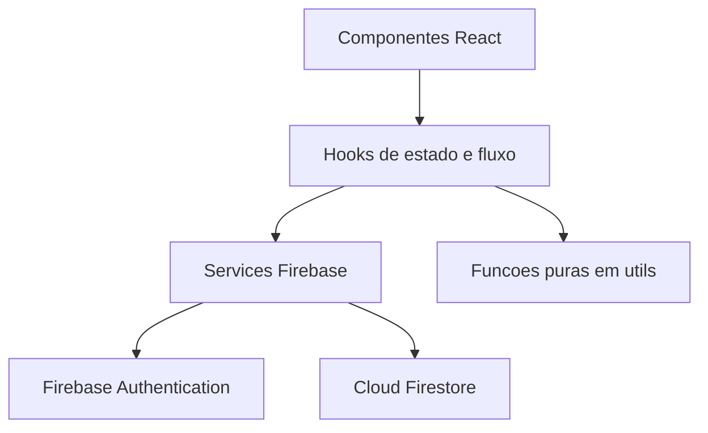
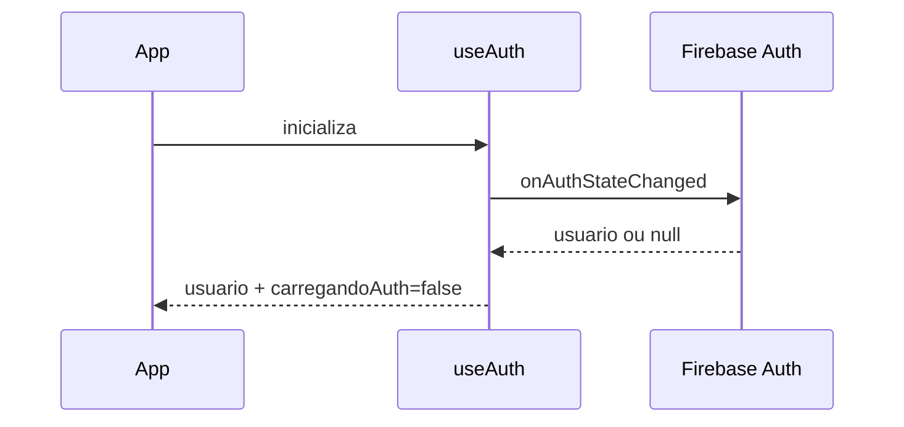
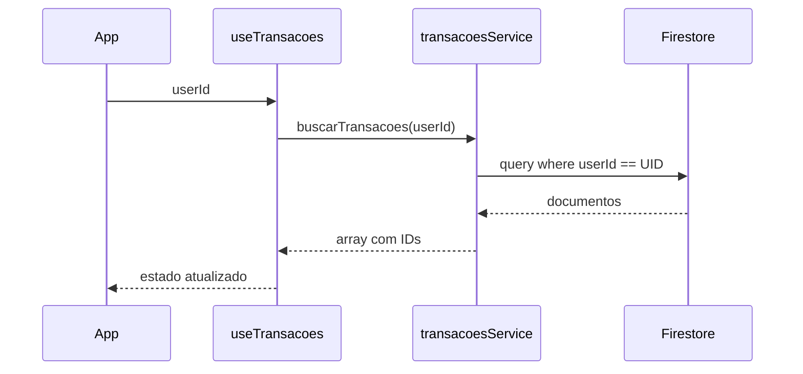

# Software Design Document - Vesttor

## 1. Informacoes do documento

- Projeto: Vesttor - Gestor Financeiro
- Tipo: aplicacao web de controle financeiro pessoal
- Stack principal: React, Vite, Firebase Authentication e Cloud Firestore
- Estado documentado em: 15 de junho de 2026
- Status: desenvolvimento e aprendizado

## 2. Objetivo

O Vesttor permite que uma pessoa autenticada cadastre e acompanhe suas
transacoes financeiras pessoais.

O sistema oferece:

- cadastro e login com email e senha;
- encerramento de sessao;
- cadastro de receitas e despesas;
- edicao e exclusao de transacoes;
- calculo de receitas, despesas e saldo;
- filtro por tipo;
- ordenacao por data ou valor;
- persistencia no Cloud Firestore;
- separacao das transacoes por usuario.

## 3. Escopo atual

### 3.1 Incluido

- autenticacao com Firebase Authentication;
- persistencia de transacoes no Firestore;
- CRUD completo de transacoes;
- validacao do formulario;
- estados de carregamento e erro;
- resumo financeiro;
- filtros e ordenacao;
- mensagem de lista vazia;
- conversao entre data do formulario e `Timestamp` do Firestore.

### 3.2 Fora do escopo atual

- recuperacao de senha;
- verificacao de email;
- login social;
- categorias;
- transacoes recorrentes;
- orcamentos;
- paginacao;
- sincronizacao em tempo real com `onSnapshot`;
- testes automatizados;
- interface visual final;
- deploy de producao;
- observabilidade e monitoramento.

## 4. Arquitetura

A aplicacao usa uma arquitetura em camadas simples:



### 4.1 Responsabilidades

| Camada | Responsabilidade |
| --- | --- |
| `components` | Interface, formularios, eventos e renderizacao |
| `hooks` | Estado, efeitos e coordenacao das operacoes |
| `services` | Comunicacao com Firebase Auth e Firestore |
| `utils` | Regras puras de calculo, validacao e transformacao |
| `config` | Inicializacao e exportacao dos servicos Firebase |

## 5. Estrutura relevante

```text
src/
|-- components/
|   |-- CardResumo.jsx
|   |-- ContainerResumo.jsx
|   |-- ControlesTransacoes.jsx
|   |-- Form.jsx
|   |-- FormAuth.jsx
|   |-- Header.jsx
|   |-- ItemTransacao.jsx
|   `-- ListaTransacoes.jsx
|-- config/
|   `-- firebase.js
|-- hooks/
|   |-- useAuth.js
|   `-- useTransacoes.js
|-- services/
|   |-- authService.js
|   `-- transacoesService.js
|-- utils/
|   |-- calculos.js
|   `-- transacao.js
|-- App.jsx
`-- main.jsx
```

`PainelTransacoes.jsx` ainda existe no repositorio, mas nao faz parte do fluxo
atual e pode ser removido depois de confirmar que nao possui uso.

## 6. Componentes

### 6.1 `App.jsx`

Responsavel por:

- obter o estado da autenticacao;
- passar o UID para `useTransacoes`;
- decidir entre carregamento, login e dashboard;
- compor resumo, formulario e lista;
- exibir erros de operacoes;
- disponibilizar a acao de logout.

O hook de transacoes e sempre chamado, mesmo antes da verificacao da sessao
terminar. Isso preserva a regra de ordem dos hooks. Quando ainda nao existe UID,
`useTransacoes` nao consulta o Firestore.

### 6.2 `FormAuth.jsx`

Formulario controlado com:

- email;
- senha;
- acao de login;
- acao de cadastro;
- mensagem de erro.

O Firebase autentica automaticamente o usuario depois de um cadastro bem
sucedido. A mudanca de sessao e observada por `useAuth`.

### 6.3 `Form.jsx`

Formulario controlado para criacao e edicao.

Estados locais:

- `data`;
- `descricao`;
- `valor`;
- `tipo`;
- `erro`.

Modos:

- sem `transacaoEditando`: cria uma transacao;
- com `transacaoEditando`: atualiza a transacao selecionada.

O campo HTML `type="date"` trabalha com texto `YYYY-MM-DD`. Ao editar, o
`Timestamp` recebido do Firestore e convertido para esse formato.

### 6.4 `ListaTransacoes.jsx`

Responsavel pelo estado visual da lista:

- filtro selecionado;
- ordenacao selecionada;
- mensagem de lista vazia;
- composicao de controles e itens.

Filtro e ordenacao nao alteram os dados persistidos.

### 6.5 `ControlesTransacoes.jsx`

Componente controlado que recebe os valores atuais e callbacks para:

- filtro: todas, receitas ou despesas;
- ordenacao: data ou valor, crescente ou decrescente.

### 6.6 `ItemTransacao.jsx`

Renderiza uma transacao e oferece as acoes:

- iniciar edicao;
- excluir.

A data e exibida convertendo o `Timestamp` com `toDate()`.

### 6.7 Resumo financeiro

`ContainerResumo` recebe os valores calculados e compoe tres `CardResumo`:

- receitas;
- despesas;
- saldo total.

## 7. Hooks

### 7.1 `useAuth`

Usa `onAuthStateChanged` para observar a sessao.

Retorna:

```js
{
  usuario,
  carregandoAuth
}
```

Fluxo:



### 7.2 `useTransacoes`

Recebe:

```js
useTransacoes(userId)
```

Responsavel por:

- manter a lista no estado;
- carregar transacoes do usuario;
- adicionar, editar e excluir;
- controlar a transacao em edicao;
- armazenar estado de carregamento e erro;
- calcular saldo, receitas e despesas.

As alteracoes locais acontecem somente depois da confirmacao do Firestore.

## 8. Services

### 8.1 `authService.js`

Encapsula:

- `createUserWithEmailAndPassword`;
- `signInWithEmailAndPassword`;
- `signOut`.

Os componentes nao importam diretamente essas funcoes do Firebase.

### 8.2 `transacoesService.js`

Encapsula o CRUD do Firestore:

| Funcao | Operacao |
| --- | --- |
| `buscarTransacoes(userId)` | consulta documentos pelo `userId` |
| `criarTransacaoNaApi(transacao, userId)` | cria documento com UID |
| `editarTransacaoNaApi(id, dados)` | atualiza documento |
| `excluirTransacaoNaApi(id)` | exclui documento |

Apesar do sufixo `NaApi`, o service atualmente usa o SDK do Firestore, nao uma
API HTTP propria. O nome pode ser simplificado futuramente.

## 9. Modelo de dados

### 9.1 Colecao

```text
transacoes
```

### 9.2 Documento

```js
{
  id: "ID gerado pelo Firestore",
  userId: "UID do Firebase Authentication",
  data: Timestamp,
  descricao: "Salario",
  valor: 3500,
  tipo: "receita"
}
```

### 9.3 Regras de dominio

- `tipo` deve ser `receita` ou `despesa`;
- `valor` deve ser numerico e maior que zero;
- `descricao` e obrigatoria;
- `data` e obrigatoria;
- cada nova transacao recebe o UID do usuario autenticado;
- o ID e gerado pelo Firestore;
- datas persistidas usam `Timestamp`.

## 10. Fluxos principais

### 10.1 Carregamento



### 10.2 Criacao

1. `Form` valida os campos.
2. `criarTransacao` normaliza o valor.
3. `useTransacoes` envia a transacao e o UID ao service.
4. O service converte a data para `Timestamp`.
5. O Firestore cria o documento e gera o ID.
6. O hook adiciona o documento retornado ao estado.

### 10.3 Edicao

1. A lista envia o item para `iniciarEdicao`.
2. O formulario recebe os dados e converte o `Timestamp`.
3. O usuario salva os novos dados.
4. O service reconverte a data para `Timestamp`.
5. `updateDoc` atualiza o documento.
6. O hook substitui apenas o item de mesmo ID.

### 10.4 Exclusao

1. `ItemTransacao` envia o ID.
2. O service cria uma referencia com `doc`.
3. `deleteDoc` remove o documento.
4. O hook remove o item do estado apos a confirmacao.

## 11. Calculos e transformacoes

### 11.1 Resumo

As funcoes de `utils/calculos.js` sao puras:

- `calcularSaldo`;
- `calcularReceitas`;
- `calcularDespesas`.

### 11.2 Filtro e ordenacao

As funcoes de `utils/transacao.js`:

- nao alteram o estado React;
- filtram por `tipo`;
- criam uma copia antes de usar `sort`;
- comparam datas por `Timestamp.toMillis()`;
- comparam valores numericamente.

## 12. Firebase

### 12.1 Inicializacao

`config/firebase.js` inicializa uma unica instancia e exporta:

- `db`: instancia do Firestore;
- `auth`: instancia do Firebase Authentication.

### 12.2 Seguranca

A consulta no frontend usa `where("userId", "==", userId)`, mas isso nao
substitui regras de seguranca.

As regras da colecao `transacoes` devem exigir:

- usuario autenticado;
- leitura apenas de documentos com o mesmo UID;
- criacao apenas quando `request.resource.data.userId` corresponde ao UID;
- alteracao e exclusao apenas pelo proprietario.

Regra-alvo:

```text
match /transacoes/{transactionId} {
  allow read: if request.auth != null
    && request.auth.uid == resource.data.userId;

  allow create: if request.auth != null
    && request.auth.uid == request.resource.data.userId;

  allow update: if request.auth != null
    && request.auth.uid == resource.data.userId
    && request.auth.uid == request.resource.data.userId;

  allow delete: if request.auth != null
    && request.auth.uid == resource.data.userId;
}
```

O bloco deve ser acrescentado ou ajustado no conjunto de regras existente do
projeto Firebase, sem remover regras de outras colecoes.

## 13. Tratamento de erros

- erros do Firebase sao capturados nos hooks ou formularios;
- `useTransacoes` expoe uma mensagem para `App`;
- formularios exibem erros de validacao ou autenticacao;
- a lista local nao e alterada quando uma operacao remota falha.

Limitacao atual: o mesmo estado `erro` e usado para carregamento e operacoes de
CRUD. Futuramente pode ser separado em `erroCarregamento` e `erroOperacao`.

## 14. Decisoes tecnicas

### 14.1 Firestore no lugar de localStorage

Permite persistencia remota, acesso em diferentes dispositivos e separacao por
usuario.

### 14.2 Service isolado

Evita chamadas Firebase dentro dos componentes e facilita trocar ou testar a
camada de dados.

### 14.3 Timestamp como formato oficial

O Firestore armazena datas como `Timestamp`. A conversao para texto ocorre
somente nas fronteiras da interface.

### 14.4 Estado derivado sem `useState`

Saldo, receitas e despesas sao recalculados a partir de `transacoes`, evitando
sincronizacao duplicada.

## 15. Pendencias e proximos passos

### Prioridade alta

1. Publicar regras seguras para `transacoes`.
2. Confirmar isolamento usando duas contas diferentes.
3. Migrar ou excluir documentos antigos sem `userId`.
4. Traduzir mensagens tecnicas do Firebase para mensagens amigaveis.

### Prioridade media

1. Adicionar estado de processamento para evitar cliques repetidos.
2. Separar erro inicial de erro de operacao.
3. Implementar recuperacao de senha.
4. Adicionar verificacao de email.
5. Remover `PainelTransacoes.jsx` se continuar sem uso.
6. Renomear funcoes com sufixo `NaApi` para nomes ligados ao Firestore.

### Qualidade

1. Criar testes para utils.
2. Criar testes dos hooks e formularios.
3. Revisar acessibilidade de labels, foco e mensagens.
4. Revisar codificacao UTF-8 dos textos.
5. Mover configuracao Firebase para variaveis de ambiente do Vite.

## 16. Criterios de aceite do estado atual

- usuario consegue criar conta e entrar;
- sessao permanece apos recarregar;
- usuario consegue sair;
- apenas transacoes consultadas pelo UID atual aparecem;
- nova transacao recebe `userId`;
- CRUD persiste apos recarregar;
- datas sao armazenadas como `Timestamp`;
- filtros e ordenacao funcionam sem alterar os dados;
- resumo acompanha as transacoes carregadas;
- falhas do Firebase geram mensagem de erro.

