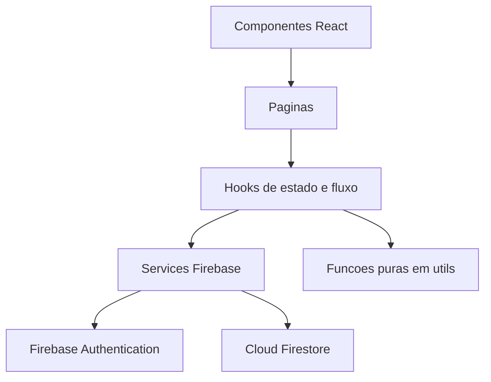
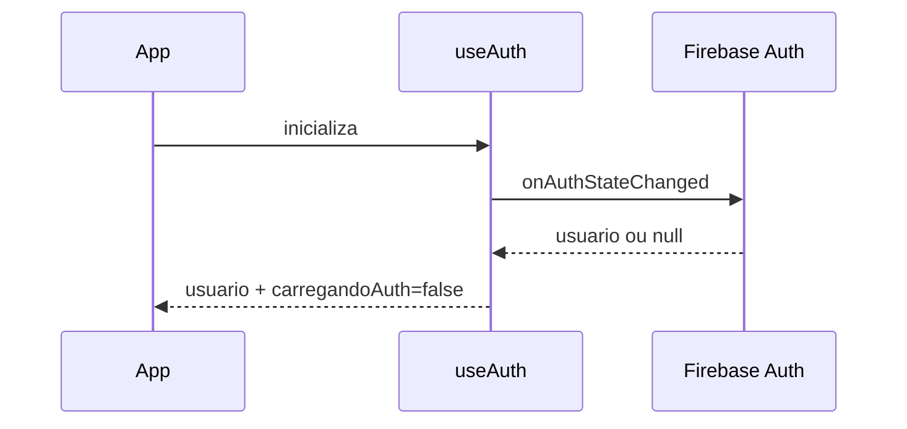

# Vesttor - Arquitetura e Implementacao

## 1. Visao tecnica

O Vesttor e uma aplicacao web criada com React, Vite, Firebase Authentication e Cloud Firestore.

Este documento registra como o projeto esta implementado, quais decisoes tecnicas foram tomadas e quais conceitos foram estudados durante a evolucao da aplicacao.

Para requisitos de produto, regras de negocio e escopo funcional, consulte `docs/requisitos.md`.

## 2. Stack principal

- React;
- Vite;
- React Router;
- Firebase Authentication;
- Cloud Firestore;
- JavaScript;
- CSS.

## 3. Arquitetura em camadas

A aplicacao usa uma arquitetura simples em camadas:



Responsabilidades:

| Camada       | Responsabilidade                                   |
| ------------ | -------------------------------------------------- |
| `pages`      | Telas acessadas por rotas                          |
| `layouts`    | Estruturas compartilhadas entre paginas            |
| `routes`     | Regras de acesso e componentes ligados a navegacao |
| `components` | Interface, formularios, listas, cards e controles  |
| `hooks`      | Estado, efeitos e coordenacao das operacoes        |
| `services`   | Comunicacao com Firebase Auth e Firestore          |
| `utils`      | Calculos, validacoes e transformacoes puras        |
| `config`     | Inicializacao dos servicos externos                |

## 4. Estrutura atual do projeto

```text
src/
|-- assets/
|   |-- edit.svg
|   `-- trash.svg
|
|-- components/
|   |-- CardResumo.jsx
|   |-- ContainerResumo.jsx
|   |-- ControlesTransacoes.jsx
|   |-- Form.jsx
|   |-- FormAuth.jsx
|   |-- Header.jsx
|   |-- ItemTransacao.jsx
|   `-- ListaTransacoes.jsx
|
|-- config/
|   `-- firebase.js
|
|-- hooks/
|   |-- useAuth.js
|   `-- useTransacoes.js
|
|-- layouts/
|   `-- AppLayout.jsx
|
|-- pages/
|   |-- Dashboard.jsx
|   `-- Login.jsx
|
|-- routes/
|   |-- PrivateRoute.jsx
|   `-- PublicRoute.jsx
|
|-- services/
|   |-- authService.js
|   `-- transacoesService.js
|
|-- utils/
|   |-- calculos.js
|   `-- transacao.js
|
|-- App.jsx
|-- App.css
|-- index.css
`-- main.jsx
```

## 5. Inicializacao da aplicacao

`src/main.jsx` cria a raiz React e envolve `App` com `BrowserRouter`.

Responsabilidade do `BrowserRouter`:

- Permitir que o React leia a URL atual;
- Controlar navegacao sem recarregar a pagina inteira;
- Habilitar `Routes`, `Route`, `Navigate`, `Outlet` e demais recursos do React Router.

Fluxo inicial:

```text
main.jsx
`-- BrowserRouter
    `-- App
```

## 6. React Router

### 6.1. Rotas atuais

Rotas atuais:

| Rota         | Tipo     | Comportamento                                               |
| ------------ | -------- | ----------------------------------------------------------- |
| `/login`     | Publica  | Exibe login apenas para usuario nao autenticado             |
| `/dashboard` | Privada  | Exibe dashboard apenas para usuario autenticado             |
| `*`          | Fallback | Redireciona para `/dashboard` ou `/login` conforme a sessao |

### 6.2. Estrutura atual em `App.jsx`

```jsx
<Routes>
  <Route
    element={
      <PrivateRoute usuario={usuario}>
        <AppLayout />
      </PrivateRoute>
    }
  >
    <Route path="/dashboard" element={<Dashboard usuario={usuario} />} />
  </Route>

  <Route
    path="/login"
    element={
      <PublicRoute usuario={usuario}>
        <Login />
      </PublicRoute>
    }
  />

  <Route
    path="*"
    element={<Navigate to={usuario ? "/dashboard" : "/login"} />}
  />
</Routes>
```

Pontos importantes:

- A rota pai protegida nao possui `path`;
- Ela serve como casca para protecao e layout;
- `/dashboard` e uma rota filha;
- A rota filha aparece dentro do `Outlet` de `AppLayout`;
- A rota `*` trata enderecos desconhecidos.

## 7. Componentes de rota

### 7.1. `PrivateRoute`

`PrivateRoute` recebe `usuario` e `children`.

Regra:

- Sem usuario: redireciona para `/login`;
- Com usuario: renderiza `children`.

Uso conceitual:

```jsx
<PrivateRoute usuario={usuario}>
  <Dashboard usuario={usuario} />
</PrivateRoute>
```

### 7.2. `PublicRoute`

`PublicRoute` representa o caso inverso.

Regra:

- Com usuario: redireciona para `/dashboard`;
- Sem usuario: renderiza `children`.

Uso conceitual:

```jsx
<PublicRoute usuario={usuario}>
  <Login />
</PublicRoute>
```

## 8. Layout compartilhado

### 8.1. `AppLayout`

`AppLayout` centraliza a estrutura comum da area autenticada.

Ele renderiza:

- `Header`;
- `main`;
- `Outlet`.

Estrutura:

```jsx
function AppLayout() {
  return (
    <>
      <Header />
      <main>
        <Outlet />
      </main>
    </>
  );
}
```

Conceito:

```text
PrivateRoute
`-- AppLayout
    |-- Header
    `-- main
        `-- Outlet
            `-- Dashboard
```

O `Outlet` marca onde a rota filha sera renderizada.

## 9. Paginas

### 9.1. `Login.jsx`

Responsabilidade:

- Compor a tela de autenticacao;
- Renderizar `FormAuth`;
- Deixar a regra de redirecionamento em `PublicRoute`.

### 9.2. `Dashboard.jsx`

Responsabilidade atual:

- Usar `useTransacoes(usuario?.uid)`;
- Renderizar resumo financeiro;
- Renderizar formulario de transacao;
- Renderizar lista de transacoes;
- Exibir carregamento e erro;
- Exibir email do usuario;
- Disponibilizar logout.

Com a criacao de `AppLayout`, `Dashboard` nao deve mais renderizar `Header` nem criar outro `main`. A estrutura comum pertence ao layout.

## 10. Autenticacao

### 10.1. `useAuth`

`useAuth` observa a sessao com `onAuthStateChanged`.

Retorno:

```js
{
  (usuario, carregandoAuth);
}
```

Fluxo:



`App` aguarda `carregandoAuth` terminar antes de decidir quais rotas exibir ou redirecionar.

### 10.2. `authService.js`

Encapsula chamadas do Firebase Authentication:

- `createUserWithEmailAndPassword`;
- `signInWithEmailAndPassword`;
- `signOut`.

## 11. Firestore e transacoes

### 11.1. `useTransacoes`

`useTransacoes(userId)` coordena o estado de transacoes.

Responsabilidades:

- Manter lista de transacoes;
- Controlar carregamento;
- Controlar erros;
- Controlar transacao em edicao;
- Adicionar, editar e excluir transacoes;
- Calcular saldo, receitas e despesas a partir da lista.

Valores derivados:

- `saldo`;
- `receitas`;
- `despesas`.

Esses valores nao ficam em estado proprio; sao calculados a partir de `transacoes`.

### 11.2. `transacoesService.js`

Encapsula operacoes do Cloud Firestore.

Funcoes atuais:

| Funcao                  | Responsabilidade                               |
| ----------------------- | ---------------------------------------------- |
| `observarTransacoes`    | Assinar transacoes do usuario com `onSnapshot` |
| `criarTransacaoNaApi`   | Criar documento no Firestore                   |
| `editarTransacaoNaApi`  | Atualizar documento existente                  |
| `excluirTransacaoNaApi` | Excluir documento                              |

A leitura usa tempo real com `onSnapshot`.

Fluxo:

```text
Dashboard
`-- useTransacoes(usuario.uid)
    `-- observarTransacoes(userId)
        `-- query transacoes where userId == uid
            `-- onSnapshot
```

Com isso, criacoes, edicoes e exclusoes sao refletidas automaticamente pelo listener.

## 12. Utilitarios

### 12.1. `utils/calculos.js`

Funcoes puras:

- `calcularSaldo`;
- `calcularReceitas`;
- `calcularDespesas`.

### 12.2. `utils/transacao.js`

Funcoes puras:

- `criarTransacao`;
- `filtrarTransacoes`;
- `ordenarTransacoes`;
- `validarTransacao`.

A ordenacao cria copia do array antes de usar `sort`, evitando mutacao direta do estado.

## 13. Modelo atual no Firestore

Colecao:

```text
transacoes
```

Documento atual:

```js
{
  id: "ID gerado pelo Firestore",
  userId: "UID do Firebase Authentication",
  data: Timestamp,
  descricao: "Salario",
  valor: 3500,
  tipo: "receita"
}
```

Datas sao armazenadas como `Timestamp` e convertidas nas fronteiras da interface.

## 14. Seguranca

A consulta do frontend filtra por `userId`, mas isso nao substitui regras de seguranca do Firestore.

Regra alvo para `transacoes`:

```text
match /transacoes/{transactionId} {
  allow read: if request.auth != null
    && request.auth.uid == resource.data.userId;

  allow create: if request.auth != null
    && request.auth.uid == request.resource.data.userId;

  allow update: if request.auth != null
    && request.auth.uid == resource.data.userId
    && request.auth.uid == request.resource.data.userId;

  allow delete: if request.auth != null
    && request.auth.uid == resource.data.userId;
}
```

No futuro, regras equivalentes deverao ser criadas para:

- `categorias`;
- `metodosPagamento`;
- `orcamentos`.

## 15. Decisoes tecnicas registradas

### 15.1. Firestore no lugar de armazenamento local

O Firestore permite persistencia remota, acesso em diferentes dispositivos e separacao por usuario autenticado.

### 15.2. Services isolados

Componentes nao chamam Firebase diretamente. A comunicacao externa fica nos services.

### 15.3. Hooks como coordenadores de fluxo

Hooks como `useAuth` e `useTransacoes` coordenam estado, efeitos e chamadas aos services.

### 15.4. Estado derivado sem `useState`

Saldo, receitas e despesas sao calculados a partir da lista de transacoes, evitando duplicacao de estado.

### 15.5. Layout compartilhado para area autenticada

`AppLayout` evita repetir `Header` e estrutura principal em cada pagina privada.

## 16. Blocos de estudo concluidos

### 16.1. Firebase e Firestore

Conceitos praticados:

- Configuracao do Firebase;
- Autenticacao com e-mail e senha;
- Separacao de dados por usuario;
- CRUD no Firestore;
- Conversao de datas para `Timestamp`;
- Listener em tempo real com `onSnapshot`.

### 16.2. Hooks customizados

Conceitos praticados:

- `useAuth` para sessao;
- `useTransacoes` para dados e operacoes;
- Separacao entre estado, services e interface;
- Cleanup de efeitos.

### 16.3. React Router

Conceitos praticados:

- `BrowserRouter`;
- `Routes`;
- `Route`;
- `Navigate`;
- Rotas privadas;
- Rotas publicas;
- `children`;
- Rota pai sem `path`;
- Rota filha;
- `Outlet`;
- Layout compartilhado.

## 17. Proximos passos tecnicos

1. Criar uma segunda pagina privada, como `/transacoes`.
2. Registrar essa pagina como rota filha do mesmo `AppLayout`.
3. Adicionar navegacao entre paginas privadas usando `NavLink`.
4. Migrar filtros locais para URL com `useSearchParams`.
5. Separar gradualmente `Dashboard` e `Transacoes`.
6. Revisar mensagens de erro do Firebase para textos amigaveis.
7. Separar erros de carregamento, operacao, autenticacao e validacao.
8. Revisar codificacao UTF-8 dos textos exibidos.
9. Mover configuracao Firebase para variaveis de ambiente do Vite.
