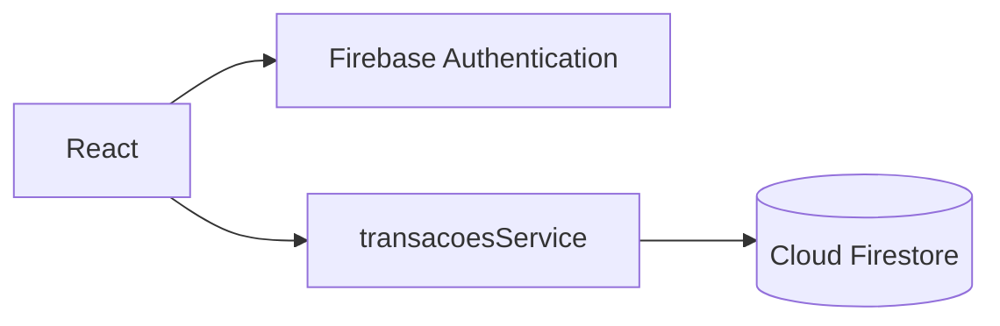
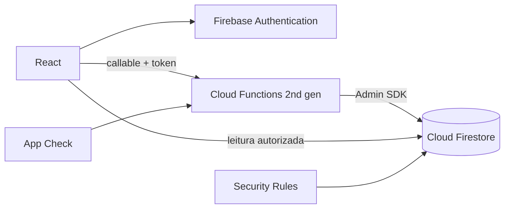

# Cloud Functions no Vesttor

> **Situação em 26/09/2026: Fora do escopo atual.** O MVP continuará usando o SDK Web do Firestore protegido por Security Rules e não exigirá plano Blaze. Functions só serão reavaliadas depois do MVP para exclusão integral de conta, convites de ambientes, notificações ou tarefas que realmente exijam execução privilegiada no servidor. A pasta e o predeploy atuais são um scaffold incompleto e não devem participar de uma publicação geral.

O Vesttor funciona sem Functions para autenticação, transações, parcelamentos em lote, planejamento, catálogos de leitura, atraso derivado e recorrências determinísticas. Publicações devem ser direcionadas por recurso.

## Proposta histórica preservada

O conteúdo abaixo registra a proposta anterior de migração para Functions. Ele não define mais a arquitetura do MVP e foi mantido somente para rastreabilidade.

## Status e objetivo

Esta e uma arquitetura alvo, ainda nao implementada. O objetivo e mover para o backend as operacoes que exigem autorizacao, validacao confiavel e protecao de regras de negocio, preservando o CRUD atual de transacoes.

## Estado atual

O React autentica com Firebase Authentication e acessa diretamente `transacoes` no Firestore para observar, criar, editar e excluir. O `userId` e originado no cliente. O filtro da consulta limita resultados, mas nao constitui autorizacao; o acesso do SDK web depende de Security Rules corretas.

Os dados continuam armazenados no mesmo projeto Firebase e na mesma base do Cloud Firestore. A migracao altera o caminho das escritas e das validacoes, nao o local de persistencia.



## Arquitetura alvo

Recomenda-se uma separacao hibrida: manter autenticacao no cliente, enviar escritas para HTTPS callable Functions e preservar a leitura em tempo real diretamente do Firestore somente com regras por proprietario.



Cloud Functions nao protege o banco sozinha. O Admin SDK ignora Security Rules; cada Function precisa validar autenticacao, autorizacao, propriedade e payload. As regras continuam responsaveis por bloquear acessos diretos indevidos.

## Responsabilidades

Frontend:

- renderizar interface, loading, sucesso e erro;
- manter Firebase Authentication;
- fazer validacao de usabilidade, sem considera-la seguranca;
- chamar `firebase/functions`;
- calcular saldo e totais para apresentacao enquanto nao forem dados persistidos.

Backend:

- rejeitar chamadas nao autenticadas;
- usar o UID do contexto, nunca `userId` recebido;
- validar tipo, formato, tamanho e limites;
- verificar propriedade antes de editar ou excluir;
- definir `userId`, `criadoEm` e `atualizadoEm` no servidor;
- retornar erros estruturados sem detalhes internos;
- usar transacoes ou lotes quando houver varios documentos.

Security Rules:

- permitir leitura somente ao proprietario autenticado;
- negar escritas diretas depois que a colecao for migrada;
- manter regras explicitas para colecoes ainda nao migradas;
- exigir consultas compativeis, pois regras nao filtram resultados automaticamente.

## Fronteira por operacao

| Operacao | Canal recomendado |
| --- | --- |
| Cadastro e login | Firebase Auth no frontend |
| Observar transacoes | Firestore no frontend, com regras |
| Criar, editar e excluir transacao | Callable Functions |
| Saldo e totais atuais | Frontend, derivados da lista |
| Relatorios extensos futuros | Function ou backend dedicado |
| Integracoes privadas futuras | Function com Secret Manager |

Variaveis `VITE_*` fazem parte do bundle publico e nunca devem conter segredos.

## Contratos iniciais

Os nomes sao propostas a confirmar na implementacao.

```js
// createTransaction: entrada
{ descricao: string, valor: number, data: string, tipo: "receita" | "despesa", idempotencyKey: string }

// createTransaction: saida
{ id: string }

// updateTransaction: entrada
{ id: string, descricao: string, valor: number, data: string, tipo: "receita" | "despesa" }

// deleteTransaction: entrada
{ id: string }
```

`data` usa `YYYY-MM-DD`. O payload nao aceita `userId`, timestamps protegidos ou ID de criacao definido pelo cliente. Erros publicos: `unauthenticated`, `invalid-argument`, `not-found`, `permission-denied` e `internal`.

Validacoes minimas:

- descricao obrigatoria, normalizada e com no maximo 100 caracteres;
- aproximadamente cinco palavras como orientacao, sem limite por palavras;
- valor finito e maior que zero, sem limite maximo de negocio;
- data valida convertida para `Timestamp` no backend, aceitando datas passadas e futuras;
- tipo somente `receita` ou `despesa`;
- rejeicao de campos desconhecidos ou protegidos;
- identidade obtida exclusivamente do contexto autenticado.


Datas futuras atendem ao registro de compras parceladas nos meses seguintes. A [proposta de interface](parcelamento.md) define os campos e a previa. A geração, o vínculo e a persistência em lote já existem no cliente para a Home; permanece pendente migrar esse contrato para Functions, adicionar idempotência no backend e concluir os testes de integração.

## Integridade, idempotencia e confirmacoes

- Toda transacao possui `userId` definido pelo backend a partir do usuario autenticado.
- O cliente nunca pode escolher ou substituir o `userId`.
- A criacao deve ser idempotente diante de duplo clique, repeticao, timeout ou retentativa.
- A chave de idempotencia deve ser estavel, associada ao usuario e persistida atomicamente com a transacao.
- Uma chamada repetida com a mesma chave retorna o resultado existente sem criar outro documento.
- Edicao e exclusao exigem confirmacao explicita na interface antes do envio.
- A confirmacao visual nao substitui autorizacao e verificacao de propriedade no backend.
## Estrutura proposta

```text
vite-vesttor/
|-- functions/
|   |-- package.json
|   |-- src/
|   |   |-- index.js
|   |   |-- transactions/
|   |   |   |-- createTransaction.js
|   |   |   |-- updateTransaction.js
|   |   |   `-- deleteTransaction.js
|   |   |-- shared/{auth,errors,validation}.js
|   |   `-- config/firebaseAdmin.js
|   `-- test/transactions/
|-- src/config/functions.js
|-- src/services/transacoesService.js
|-- firestore.rules
|-- firestore.indexes.json
`-- firebase.json
```

## Plano incremental

1. Baseline: versionar e testar `firestore.rules`, confirmar isolamento com duas contas e auditar documentos sem `userId`.
2. Backend: inicializar Functions 2nd gen, Admin SDK, validadores, erros e emuladores.
3. Escritas: implementar idempotencia e migrar primeiro criacao, depois edicao e exclusao; somente entao negar escrita direta.
4. Endurecimento: habilitar App Check, revisar IAM, logs, alertas e custos; usar Secret Manager quando necessario.
5. Novos dominios: repetir o padrao para categorias, pagamentos, orcamentos e relatorios depois de confirmar suas regras.

## Criterios de aceite

- O UID persistido vem do contexto da Function, independentemente do payload.
- Toda transacao persistida possui `userId`.
- Um usuario nao edita, exclui nem le transacoes de outro.
- Escritas diretas sao negadas depois da migracao.
- A leitura em tempo real continua restrita ao proprietario.
- Payload malformado ou com campos protegidos e rejeitado sem alterar dados.
- Chamadas simultaneas ou sequenciais com a mesma chave de idempotencia geram uma unica transacao.
- Edicao e exclusao pedem confirmacao explicita.
- Criar, editar, excluir, filtrar, ordenar e recalcular o resumo continuam funcionando.

## Validacoes esperadas

- Testes unitarios dos validadores.
- Testes de integracao com Functions e Firestore Emulators.
- Testes das regras com proprietario, outro usuario e usuario anonimo.
- Teste manual com duas contas e tentativa de forjar `userId`.
- Testes de descricao com 100 e 101 caracteres.
- Testes com valores positivos altos e datas passadas e futuras.
- Testes de retentativas simultaneas e sequenciais com a mesma chave de idempotencia.
- Teste manual das confirmacoes de edicao e exclusao.
- `npm run lint`, `npm run test:run` e `npm run build` no frontend.
- Lint e testes separados dentro de `functions`.

## Riscos e pendencias

- Bloquear regras antes de trocar o frontend interrompe o CRUD.
- Manter os dois caminhos de escrita por muito tempo amplia a superficie de ataque.
- Falhas de autorizacao no Admin SDK podem afetar qualquer documento.
- App Check reduz abuso, mas nao substitui autenticacao e autorizacao.
- Regiao, memoria e limites afetam latencia e custo.
- Dados financeiros e tokens nao devem aparecer em logs.

Decisoes confirmadas: descricao de ate 100 caracteres; valor positivo sem maximo de negocio; datas passadas e futuras; toda transacao com `userId`; dados no mesmo Firestore; leitura em tempo real; confirmacoes antes de editar e excluir; e criacao obrigatoriamente idempotente.

Continuam pendentes: região, memória, concorrência e limites das Functions; documentos antigos; auditoria; formato e retenção da chave de idempotência; migração do parcelamento já existente no cliente; App Check, IAM, logs, alertas e custos.

## Referencias oficiais

- [Call functions from your app](https://firebase.google.com/docs/functions/callable)
- [Get started with Cloud Firestore Security Rules](https://firebase.google.com/docs/firestore/security/get-started)
- [Securely query data](https://firebase.google.com/docs/firestore/security/rules-query)
- [Configure your environment and secrets](https://firebase.google.com/docs/functions/config-env)
