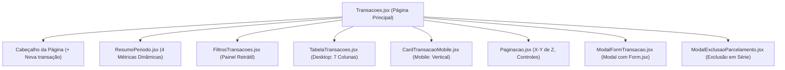

# Especificação Funcional e Técnica: Transações V2

Documento de especificação técnica e de design para a página de **Transações V2**, elaborado a partir do Figma oficial (**Node 222:2 — Transações V2**) e alinhado via sessão de refinamento de domínio (_grilling_).

---

## 1. Visão Geral

A página `/transacoes` constitui o extrato financeiro completo do Vesttor, permitindo que o usuário consulte, filtre, ordene, crie, edite e exclua qualquer movimentação (passada, presente ou futura) sem as restrições de espaço da Home.

### 1.1. Referências de Design no Figma

- **Arquivo**: `Vesttor — Design System`
- **Node ID**: [`222:2` (Transações V2)](https://www.figma.com/design/fDeglPOLWDf4zxIikgYEXv/Vesttor-%E2%80%94-Design-System?node-id=222-2&m=dev)
- **Variações no Figma**:
  - `Transações / Desktop / Escuro — V2` (Node `#222:5`, 1440 × 860 px)
  - `Transações / Mobile / Escuro — V2` (Node `#223:2`, 390 × 1154 px)
  - `Transações / Desktop / Claro — V2` (Node `#224:2`, 1440 × 860 px)
  - `Transações / Mobile / Claro — V2` (Node `#224:136`, 390 × 1154 px)

---

## 2. Decisões de Produto e Negócio (Alinhamento Grilling)

| Item                           | Decisão Aprovada                             | Racional                                                                                                                                     |
| :----------------------------- | :------------------------------------------- | :------------------------------------------------------------------------------------------------------------------------------------------- |
| **Q1: Nova Transação**         | **Modal flutuante na tela**                  | Evita redirecionar para a Home; o usuário adiciona a movimentação e continua no extrato com feedback instantâneo.                            |
| **Q2: Resumo do Período**      | **Dinâmico conforme filtros**                | Se o usuário filtrar por "Setembro de 2026" ou por "Alimentação", as 4 métricas calculam os valores exatos daquele recorte.                  |
| **Q3: Abertura de Filtros**    | **Painel retrátil (Accordion)**              | O botão `Abrir filtros` expande suavemente um painel acima da tabela no Desktop e gaveta no Mobile, mantendo a tela limpa quando fechado.    |
| **Q4: Paginação**              | **10 itens Desktop / 8 itens Mobile**        | Paginação clássica com indicador textual (`1–10 de 12 transações`) e botões (`‹`, `1`, `›`), garantindo performance sem sobrecarregar o DOM. |
| **Q5: Compras Parceladas**     | **Extrato por competência**                  | Cada parcela aparece no seu respectivo mês de vencimento (ex: `1/10` em setembro, `2/10` em outubro), com a badge de identificação.          |
| **Q6: Subtítulo na Descrição** | **"À vista" ou "Parcela X/Y" para despesas** | Para Despesas, exibe se foi `À vista` ou `Parcela X/Y`; para Receitas, não exibe subtítulo adicional, mantendo o layout enxuto.              |

---

## 3. Tokens Visuais e Paleta de Cores (Figma V2)

### 3.1. Tema Escuro (Dark Mode)

- **Fundo da Página**: `#050B16`
- **Superfície de Cards e Tabela**: `#0B1F33`
- **Bordas**: `#1E4666` (1px solid)
- **Linhas Alternadas (Zebrado da Tabela)**: `#102A42` com opacidade de 35%
- **Tipografia e Textos**:
  - Títulos e Destaques: `#F6F8FB` (Inter, 700 / 600)
  - Textos de Apoio / Rótulos: `#9FB0C3` (Inter, 400 / 500)
- **Cores Semânticas**:
  - Saldo / Primário: `#20AEFF` / `#2D79FF`
  - Receitas: `#2DD4A4` (Fundo da Badge: `#0E776B`, texto `#2DD4A4`)
  - Despesas: `#FF5967` (Fundo da Badge: `#6A2634`, texto `#FF5967`)
  - Botão Primário (`+ Nova transação`): Fundo `#2D79FF`, texto `#050B16`, border-radius 10px
  - Botões de Ação (`Editar` e `Excluir`): Fundo `#17324A`, borda `#1E4666`, texto `#9FB0C3`

### 3.2. Tema Claro (Light Mode)

- **Fundo da Página**: `#F4F8FC`
- **Superfície de Cards e Tabela**: `#FFFFFF`
- **Bordas**: `#D5E2EC` (1px solid)
- **Linhas Alternadas (Zebrado da Tabela)**: `#EFF4F8` com opacidade de 35%
- **Tipografia e Textos**:
  - Títulos e Destaques: `#04111F` (Inter, 700 / 600)
  - Textos de Apoio / Rótulos: `#617489` (Inter, 400 / 500)
- **Cores Semânticas**:
  - Saldo / Primário: `#087FC4`
  - Receitas: `#0E9F76` (Fundo da Badge: `#E8FFF8`, texto `#0E9F76`)
  - Despesas: `#D9364F` (Fundo da Badge: `#FFF0F2`, texto `#D9364F`)
  - Botão Primário: Fundo `#2D79FF`, texto `#FFFFFF`, border-radius 10px
  - Botões de Ação (`Editar` e `Excluir`): Fundo `#1B7543EA`, borda `#09D1FFDF`, texto `#04111F`

---

## 4. Arquitetura de Componentes da Tela



### 4.1. Cabeçalho da Página

- **Título**: `Transações` (30px, bold).
- **Subtítulo**: _"Encontre, filtre e gerencie todas as suas movimentações."_ (14px, muted).
- **CTA Principal**: Botão `+ Nova transação` (13px, semibold, raio 10px). Dispara a abertura do `ModalFormTransacao`.

### 4.2. Barra de Resumo do Período (`ResumoPeriodo.jsx`)

Exibe 4 métricas calculadas em tempo real sobre a lista filtrada:

1. **Saldo no período**: Valor formatado em BRL (`#20AEFF` no dark).
2. **Receitas**: Soma total de entradas do período (`#2DD4A4`).
3. **Despesas**: Soma total de saídas do período (`#FF5967`).
4. **Movimentações**: Quantidade total de registros (ex: `12 registros`).

### 4.3. Cabeçalho da Listagem e Controles

- **Contagem e Ordenação**: Texto `X transações` e subtítulo _"Ordenadas por data, das mais recentes para as mais antigas."_.
- **Indicador de Saldo**: Texto resumido à direita: `Saldo do período  + R$ 3.650,00`.
- **Botão `Abrir filtros`**: Botão com ícone SVG estilizado que alterna o estado aberto/fechado do painel de filtros.

### 4.4. Painel Retrátil de Filtros (`FiltrosTransacoes.jsx`)

Quando expandido, disponibiliza:

- **Busca Textual**: Input com ícone de lupa para filtrar por descrição em tempo real.
- **Filtro por Tipo**: Pills de seleção única (`Todas`, `Receitas`, `Despesas`).
- **Seletor de Competência (Mês/Ano)**: Dropdown com os meses disponíveis no histórico do usuário ou opção "Todos os períodos".
- **Filtro por Categoria**: Dropdown com as categorias cadastradas.
- **Filtro por Método de Pagamento**: Dropdown com os métodos (Pix, Cartão de Crédito, Boleto, etc.).
- **Ordenação**: Dropdown com opções: Mais recentes, Mais antigas, Maior valor, Menor valor.
- **Ação Rápida**: Botão _"Limpar filtros"_ para restaurar os padrões com um clique.

### 4.5. Tabela Desktop (`TabelaTransacoes.jsx`)

Colunas da tabela (layout em grid com 7 colunas):

1. **Data**: Formato `DD/MM/AAAA` (13px, regular, muted).
2. **Descrição**:
   - Ícone quadrado com inicial da transação (ex: `M` para Mercado, `S` para Salário).
   - Linha 1: Nome principal da movimentação (14px, semibold).
   - Linha 2: Subtítulo contextual:
     - Se Despesa parcelada: `Parcela X/Y · Yx` (12px, muted).
     - Se Despesa avulsa: `À vista` (12px, muted).
     - Se Receita: sem subtítulo (limpo).
3. **Categoria**: Nome da categoria (13px, regular).
4. **Método**: Método de pagamento utilizado (13px, regular).
5. **Tipo**: Badge em formato de pílula (`Despesa` ou `Receita`) com cores semânticas.
6. **Valor**: Valor monetário alinhado à direita com sinal explícito (`− R$ 120,00` ou `+ R$ 5.800,00`).
7. **Ações**: Botões de ação rápida estilizados:
   - `Editar`: Abre o modal em modo de edição.
   - `Excluir`: Dispara exclusão direta para transações avulsas ou o modal `ModalExclusaoParcelamento` para parceladas.

### 4.6. Cards Mobile (`CardTransacaoMobile.jsx`)

Exibição otimizada para telas < 768px:

- **Linha Superior**: Ícone quadrado + Título da movimentação + Valor em destaque com sinal.
- **Segunda Linha**: Subtítulo (`À vista` ou `Parcela X/Y`).
- **Terceira Linha**: Metadados separados por bullet (`16 set · Alimentação · Pix`).
- **Rodapé**: Badge do Tipo à esquerda + botões `Editar` e `Excluir` à direita.

### 4.7. Paginação (`Paginacao.jsx`)

- Indicador à esquerda: `1–10 de 25 transações` (ou `1–8 de 25` no mobile).
- Controles à direita:
  - Botão Anterior (`‹`), desabilitado na primeira página.
  - Botões numéricos de páginas (`1`, `2`, `3`), com a página ativa destacada em azul (`#2D79FF`).
  - Botão Próximo (`›`), desabilitado na última página.

### 4.8. Modal de Nova / Edição de Transação (`ModalFormTransacao.jsx`)

- Envolve o componente `Form.jsx` em uma janela modal flutuante.
- Suporta fechamento por clique fora (backdrop blur), tecla Escape e botão "X" no topo.
- Permite adicionar novas movimentações ou atualizar séries parceladas atomicamente via `writeBatch`.

---

## 5. Algoritmos e Lógica Pura (`src/utils/transacao.js`)

### 5.1. Filtragem Avançada Multi-critério

```javascript
export function aplicarFiltrosAvancados(transacoes = [], filtros = {}) {
  // 1. Termo de busca (case-insensitive na descrição)
  // 2. Filtro por tipo (todas | receita | despesa)
  // 3. Filtro por competência mensal (YYYY-MM)
  // 4. Filtro por categoria
  // 5. Filtro por método de pagamento
  // 6. Ordenação (data ou valor)
}
```

### 5.2. Paginação Pura

```javascript
export function paginarTransacoes(
  itens = [],
  paginaAtual = 1,
  itensPorPagina = 10,
) {
  // Retorna { itens, totalItens, totalPaginas, paginaAtual, de, ate, temAnterior, temProxima }
}
```

---

## 6. Próximos Passos de Estudo e Implementação

1. [x] Conduzir refinamento de requisitos e _grilling_ com o usuário.
2. [x] Inspecionar nós e extrair tokens do Figma Node `222:2`.
3. [x] Criar testes unitários para filtros avançados e paginação (36/36 testes aprovados).
4. [x] Consolidar a documentação de produto em `docs/requisitos.md` e técnica em `docs/arquitetura.md`.
5. [ ] Construir componentes visuais (`ResumoPeriodo`, `FiltrosTransacoes`, `TabelaTransacoes`, `CardTransacaoMobile`, `Paginacao`, `ModalFormTransacao`).
6. [ ] Integrar a página `Transacoes.jsx` com o hook `useTransacoes` e validar a experiência completa.
